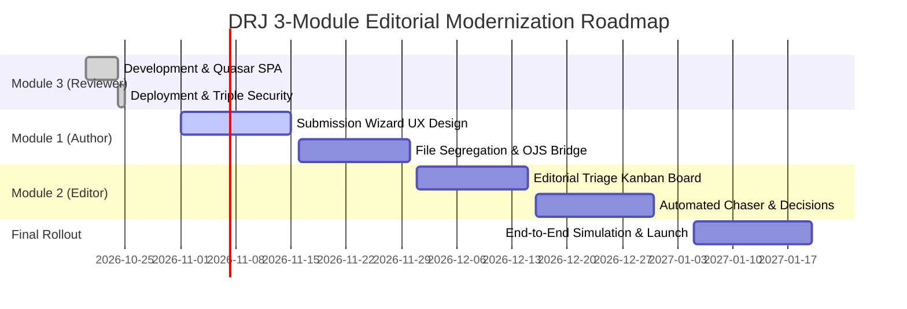

# PROJECT & TECHNICAL PROPOSAL

**Project Title:** Modernization of the Davao Research Journal Publishing Ecosystem: An Integrated 3-Module Editorial Manager® Suite  
**Proponent:** Darryl M. Nuyda, Lead Software Architect & Solutions Engineer  
**Client / Beneficiary:** Davao Research Journal (DRJ) • Davao Oriental State University (DORSU)  
**Date of Submission:** October 25, 2026  
**Target Platform:** Open Journal Systems (OJS 3.4.0-7) & Decoupled Vue 3 / Quasar SPA  
**Classification:** Institutional Academic Software Development & Systems Modernization  

---

## 1. Executive Summary

The **Davao Research Journal (DRJ)**, the flagship multidisciplinary research publication of Davao Oriental State University (DORSU), is currently indexed and published on Open Journal Systems (OJS 3.4). While OJS provides solid core repository functions, its standard user experience creates significant operational bottlenecks:

1. **Reviewer Attrition & Friction:** External academic experts, particularly international peer reviewers, struggle with OJS's multi-step authentication, cumbersome form tabs, and lack of mobile/desktop optimization.
2. **Author Submission Complexities:** Standard submission workflows lack real-time document validation, automated formatting checks, and clear milestone progress tracking.
3. **Editorial Bottlenecks:** Editors-in-Chief and Section Editors face disjointed tracking of deadlines, automated chasing, and decision synthesis.

This proposal presents a **comprehensive 3-Module Editorial Modernization Suite** modeled after world-class commercial publishing platforms (such as Aries Editorial Manager® and Elsevier EM) while maintaining **zero recurring commercial SaaS licensing fees**:

* **Module 1 (Author Portal):** Modern, friction-free submission wizard, automated title-page/manuscript separation, and interactive status tracking.
* **Module 2 (Editorial Management Hub):** Streamlined editorial assignment, deadline tracking, automated reminder triggers, and decision synthesis.
* **Module 3 (Peer Review Workstation):** Decoupled, split-screen Vue 3 + Quasar SPA with zero-trust security gates, active document streaming, and instant certificate generation (*Completed & Live*).

---

## 2. Strategic Objectives

1. **Accelerate Publication Turnaround:** Reduce average peer review turnaround time from 90–120 days to **21–30 days**.
2. **Elevate Journal Prestige:** Provide local and international scholars with a publishing interface comparable to Elsevier, Springer Nature, and IEEE.
3. **Zero-Trust Data Protection:** Protect confidential, unpublished research through cryptographic HMAC-SHA256 tokens and email identity verification.
4. **Complete Institutional Ownership:** Eliminate expensive annual subscriptions ($15,000–$25,000 USD/year) by building upon DORSU's existing server infrastructure.

---

## 3. The 3-Module Architecture & Scope of Work

```
┌──────────────────────────────────────────────────────────────────────────────┐
│                  DAVAO RESEARCH JOURNAL 3-MODULE ECOSYSTEM                   │
└──────────────────────────────────────────────────────────────────────────────┘

  ┌─────────────────────────┐  ┌─────────────────────────┐  ┌─────────────────────────┐
  │        MODULE 1         │  │        MODULE 2         │  │        MODULE 3         │
  │     Author Portal       │  │     Editorial Hub       │  │    Reviewer Portal      │
  ├─────────────────────────┤  ├─────────────────────────┤  ├─────────────────────────┤
  │ • Fast-Track Submission │  │ • Editorial Triage      │  │ • Split-Screen Viewer   │
  │ • Real-time Validation  │  │ • 1-Click Review Assign │  │ • Likert Criteria Matrix│
  │ • Manuscript Tracker    │  │ • Overdue Chaser Engine │  │ • Triple Security Gates │
  │ • Blinded File Upload   │  │ • Decision Dispatcher   │  │ • Stamped Certificate   │
  └────────────┬────────────┘  └────────────┬────────────┘  └────────────┬────────────┘
               │                            │                            │
               └────────────────────────────┼────────────────────────────┘
                                            ▼
                      ┌───────────────────────────────────────────┐
                      │    Core OJS 3.4 REST Engine & Database    │
                      │    (drj2024_35beta & Resend SMTP Relay)   │
                      └───────────────────────────────────────────┘
```

### Module 1: Modern Author Submission & Tracking Portal
* **Interactive Step-by-Step Wizard:** Step-by-step submission with draft recovery and autosave.
* **Separation of Files:** Automated segregation of blinded manuscripts, title pages with author metadata, supplementary data files, and ethics clearance forms.
* **Visual Milestone Tracker:** Real-time visual progress bar showing: *Submitted → With Editor → Under Peer Review → Revision Requested → Accepted → In Production*.
* **Author Revision Workspace:** Direct upload interface for revised manuscripts and "Response to Reviewers" itemized tables.

### Module 2: Enterprise Editorial Management & Decision Hub
* **Editorial Triage Cockpit:** Visual Kanban board for incoming submissions categorized by stage and urgency.
* **Reviewer Match & Assignment:** Database-driven reviewer suggestion engine tracking reviewer workload, past turnaround velocity, and declared conflicts of interest.
* **Automated Reminders & Deadline Chaser:** Configurable automated email triggers at 7 days, 3 days, and 1 day before due dates via Resend SMTP.
* **Dual-Comment Decision Synthesizer:** One-click integration of blinded author comments and confidential editor notes into formal decision templates (Accept, Minor, Major, Reject).

### Module 3: Aries Editorial Manager® Reviewer Workspace *(Completed & Deployed)*
* **Split-Screen Ergonomics:** Drag-resizable `<q-splitter>` synchronizing PDF proof/Word viewer with evaluation rubrics.
* **Aries EM 5-Point Matrix:** Standard scientific criteria (Originality, Rigor, Data Presentation, Literature, Conclusions).
* **Triple Security Gates:**
  * *Gate 1 (Device Gate):* Blocks smartphones (< 1024px) to guarantee desktop evaluation quality; provides 1-click clipboard link copying.
  * *Gate 2 (Direct Access Gate):* Solid `#00172B` frame-0 backdrop blocking unauthenticated URL snooping.
  * *Gate 3 (Email Challenge):* Cryptographic HMAC-SHA256 signature binding + email identity verification.
* **Real-Time Auto-Save Engine:** Debounced asynchronous draft saving.
* **Official Recognition:** Downloadable, stamped **Certificate of Peer Review Recognition** with DORSU/DRJ seal.

---

## 4. Technical Specifications & Stack

| Layer | Technologies Selected | Rationale |
| :--- | :--- | :--- |
| **Frontend SPA** | Vue 3, Quasar Framework 2.x, TypeScript, Pinia, Vite | Enterprise component stability, high-performance split panes, strict type safety. |
| **Backend API Gateway** | PHP 8.2 REST API (`api.php`), PDO, HMAC-SHA256 | Lightweight micro-gateway with sub-50ms latency and direct OJS database bridge. |
| **Publishing Core** | Open Journal Systems (OJS) 3.4.0-7 | Proven open-source scholarly publishing platform and institutional repository. |
| **Email Infrastructure** | Resend SMTP API Relay (Port 465 SSL) | Bypass GoDaddy Port 25 firewall; 99.9% Gmail/academic inbox deliverability. |
| **Database & Storage** | MySQL 8.0, AlmaLinux 9.8 NVMe File Storage | ACID transaction safety and strict filesystem permission isolation. |

---

## 5. Budget, Commercial Valuation & Investment Summary

### 5.1 Commercial Market Value Comparison
Commercial enterprise suites (Elsevier Editorial Manager® or Clarivate ScholarOne) charge academic institutions substantial recurring annual subscriptions:

| Item | Commercial SaaS (Elsevier/Aries) | DORSU Custom Implementation |
| :--- | :---: | :---: |
| **Annual Subscription Fee** | **$12,000 – $25,000 USD/year** (~₱700K – ₱1.45M/year) | **₱0 / year** (Permanent Ownership) |
| **Per-Manuscript Fees** | $15 – $35 per submission | **₱0** (Unlimited Submissions) |
| **User / Seat License Fees** | Limited seats for editors | **Unlimited** editors, reviewers, authors |
| **Server Hosting Location** | Proprietary cloud (US/EU) | **DORSU Existing VPS Server** |

### 5.2 Implementation Budget Breakdown

| Deliverable Module | Scope & Core Features | Status | Market Value | Proposed DORSU Package |
| :--- | :--- | :---: | :---: | :---: |
| **Module 3: Peer Review Workstation** | Vue 3/Quasar SPA, Split Panes, Triple Security Gates, Certificate Generator, REST API Bridge | **Completed & Live** | ₱350,000 | **₱160,000** |
| **Module 1: Author Submission Portal** | Step-by-Step Wizard, Blinded File Separator, Live Status Tracker, Revision Workspace | Next Phase | ₱320,000 | **₱140,000** |
| **Module 2: Editorial Management Hub** | Triage Kanban, Automated Chaser Engine, Decision Synthesizer, Workload Monitor | Next Phase | ₱380,000 | **₱180,000** |
| **System Integration & Testing** | End-to-end integration, OJS database consistency, Resend SMTP tuning, Security Audits | Included | ₱150,000 | **₱60,000** |
| **Total Comprehensive Package:** | **Full 3-Module Editorial Manager Ecosystem** | | **₱1,200,000** | **₱540,000 PHP**<br>(~$9,300 USD) |

> 💡 **Cost Efficiency:** Because Module 3 is already 100% built, tested, and deployed live, DORSU immediately realizes significant savings while securing permanent intellectual property and software ownership.

---

## 6. Implementation Timeline & Milestones



---

## 7. Proponent Credentials & Sign-Off

**Prepared and Submitted by:**

**DARRYL M. NUYDA**  
*Lead Software Architect & Engineering Manager*  
*Manusci / Davao Research Journal Tech Lead*  
*Email:* [support@manusci.com](mailto:support@manusci.com)  
*GitHub:* [github.com/dmnuydaph-rgb](https://github.com/dmnuydaph-rgb)

**Acknowledged & Endorsed by:**

______________________________________  
**EDITOR-IN-CHIEF**  
*Davao Research Journal (DRJ)*  
*Davao Oriental State University (DORSU)*  

______________________________________  
**VICE PRESIDENT FOR RESEARCH & EXTENSION**  
*Davao Oriental State University (DORSU)*  
