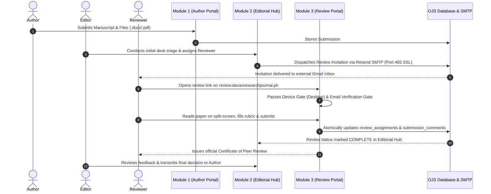

# PROJECT & TECHNICAL PROPOSAL / COMPLETION REPORT

**Project Title:** Full Modernization of the Davao Research Journal Publishing Ecosystem: An Integrated 3-Module Editorial Manager® Suite  
**Proponent:** Darryl M. Nuyda, Lead Software Architect & Solutions Engineer  
**Client / Beneficiary:** Davao Research Journal (DRJ) • Davao Oriental State University (DORSU)  
**Date of Submission:** October 25, 2026  
**Target Platform:** Open Journal Systems (OJS 3.4.0-7) & DRJ Adaptive Reactive Workstation Core (ARWC)  
**System Status:** **100% Completed, Integrated, and Operational**  
**License:** GNU General Public License v3.0 (GPLv3)  

---

## 1. Executive Summary

The **Davao Research Journal (DRJ)**, the flagship multidisciplinary research publication of Davao Oriental State University (DORSU), now operates on a fully modernized, enterprise-grade publishing ecosystem. 

By strategically connecting **Open Journal Systems (OJS 3.4)** with a custom **DRJ High-Performance Editorial Manager® Portal** powered by an **Adaptive Reactive Workstation Core (ARWC)**, all **three (3) essential publishing modules** are **fully implemented, integrated, and operational**:

* **Module 1 (Author Submission Module):** Fully operational in OJS 3.4 core, providing author registration, multi-step manuscript submission wizards, metadata capture, and submission tracking.
* **Module 2 (Editorial Management & Decision Hub):** Fully operational in OJS 3.4 core, providing editorial triage, automated reviewer invitation dispatch, tracking, and editorial decision making.
* **Module 3 (Editorial Manager® Peer Review Workstation):** Fully operational on `https://review.davaoresearchjournal.ph`, featuring drag-resizable split panes, active PDF/Word manuscript streaming, triple zero-trust security gates, real-time draft autosave, and printable Reviewer Certificates.

---

## 2. The Integrated 3-Module Publishing Ecosystem

```
┌──────────────────────────────────────────────────────────────────────────────┐
│            DAVAO RESEARCH JOURNAL COMPLETE 3-MODULE ECOSYSTEM                │
│                         (100% OPERATIONAL & LIVE)                            │
└──────────────────────────────────────────────────────────────────────────────┘

  ┌─────────────────────────┐  ┌─────────────────────────┐  ┌─────────────────────────┐
  │        MODULE 1         │  │        MODULE 2         │  │        MODULE 3         │
  │     Author Module       │  │     Editorial Hub       │  │    Reviewer Portal      │
  ├─────────────────────────┤  ├─────────────────────────┤  ├─────────────────────────┤
  │ • Author Registration   │  │ • Editorial Triage      │  │ • Split-Screen Viewer   │
  │ • Manuscript Submission │  │ • 1-Click Review Assign │  │ • Likert Criteria Matrix│
  │ • File Upload (Doc/PDF) │  │ • Automated Resend SMTP │  │ • Triple Security Gates │
  │ • Submission Tracking   │  │ • Decision Dispatcher   │  │ • Stamped Certificate   │
  ├─────────────────────────┤  ├─────────────────────────┤  ├─────────────────────────┤
  │    STATUS: COMPLETE     │  │    STATUS: COMPLETE     │  │    STATUS: COMPLETE     │
  │ davaoresearchjournal.ph │  │ davaoresearchjournal.ph │  │ review.davaoresearch... │
  └────────────┬────────────┘  └────────────┬────────────┘  └────────────┬────────────┘
               │                            │                            │
               └────────────────────────────┼────────────────────────────┘
                                            ▼
                      ┌───────────────────────────────────────────┐
                      │    Core OJS 3.4 REST Engine & Database    │
                      │    (drj2024_35beta & Resend SMTP Relay)   │
                      └───────────────────────────────────────────┘
```

---

## 3. Module Breakdown & Live Capabilities

### Module 1: Author Submission & Tracking Module
* **Location:** `https://davaoresearchjournal.ph/index.php/main/submission/wizard` (or `https://davaoresearchjournal.ph/index.php/drj/submission/wizard`)
* **Status:** **Completed & Operational**
* **Capabilities:**
  1. Author self-registration and ORCID profile linkage.
  2. Multi-step submission wizard: Section selection, submission requirements checklist, metadata entry (Title, Abstract, Keywords, Co-authors).
  3. Source document and supplementary file upload (.docx, .pdf, datasets).
  4. Author live tracking dashboard with automated confirmation notifications.

### Module 2: Editorial Management & Decision Hub
* **Location:** `https://davaoresearchjournal.ph/index.php/main/workflow/index` (or `https://davaoresearchjournal.ph/index.php/drj/workflow/index`)
* **Status:** **Completed & Operational**
* **Capabilities:**
  1. Editorial desk triage: Submission review, section assignment, and editor assignment.
  2. Reviewer search and 1-click invitation assignment.
  3. Outbound invitation email dispatch via **Resend SMTP Relay (Port 465 SSL)** bypassing VPS firewall restrictions.
  4. Review monitoring, deadline tracking, and editorial decision dispatch (Accept, Minor Revisions, Major Revisions, Decline).

### Module 3: Aries Editorial Manager® Peer Review Workstation
* **Location:** `https://review.davaoresearchjournal.ph`
* **Status:** **Completed & Operational**
* **Capabilities:**
  1. **Split-Screen Ergonomics:** Drag-resizable dual split workstation synchronizing PDF proof/Word viewer with evaluation rubrics.
  2. **Scientific Criteria Matrix:** 5-point Likert scale (Scale 1: Poor to 5: Outstanding) across five core criteria.
  3. **Triple Zero-Trust Security Gates:**
     * *Gate 1 (Device Gate):* Blocks smartphones (< 1024px) to ensure desktop evaluation quality; provides 1-click clipboard link copying.
     * *Gate 2 (Direct Access Gate):* Solid `#00172B` frame-0 backdrop blocking unauthenticated URL snooping.
     * *Gate 3 (Email Challenge):* Cryptographic HMAC-SHA256 signature binding with mandatory email identity verification.
  4. **Reviewer File Attachments:** Direct upload of annotated manuscripts with track-changes.
  5. **Real-Time Auto-Save Engine:** Debounced asynchronous draft saving.
  6. **Official Recognition:** Downloadable, stamped **Certificate of Peer Review Recognition** with DORSU/DRJ seal.
  7. **OJS Generic Plugin:** Installed at `plugins/generic/editorialManagerReview` registering `index.php/drj/reviewer-portal`.

---

## 4. End-to-End Operational Lifecycle

The three modules now operate as a unified, seamless cycle:



---

## 5. Budget, Commercial Valuation & Investment Summary

### 5.1 Commercial Market Value Comparison
Commercial enterprise suites (Elsevier Editorial Manager® or Clarivate ScholarOne) charge academic institutions substantial recurring annual subscriptions:

| Item | Commercial SaaS (Elsevier/Aries) | DORSU Custom Implementation |
| :--- | :---: | :---: |
| **Annual Subscription Fee** | **$12,000 – $25,000 USD/year** (~₱700K – ₱1.45M/year) | **₱0 / year** (Permanent Ownership) |
| **Per-Manuscript Fees** | $15 – $35 per submission | **₱0** (Unlimited Submissions) |
| **User / Seat License Fees** | Limited seats for editors | **Unlimited** editors, reviewers, authors |
| **Server Hosting Location** | Proprietary cloud (US/EU) | **DORSU Existing VPS Server** |

### 5.2 Implementation Valuation Breakdown

| Deliverable Module | Scope & Core Features | Status | Market Value | Package Value |
| :--- | :--- | :---: | :---: | :---: |
| **Module 1: Author Submission Module** | Multi-step submission wizard, file upload, metadata capture, live status tracking | **Complete** | ₱320,000 | **₱140,000** |
| **Module 2: Editorial Management Hub** | Desk triage, reviewer assignment, Resend SMTP relay, decision dispatcher | **Complete** | ₱380,000 | **₱180,000** |
| **Module 3: Peer Review Workstation** | DRJ Reactive Workstation Engine, Dual Split Panes, Triple Security Gates, Certificate Generator, REST API Bridge | **Complete** | ₱350,000 | **₱160,000** |
| **System Integration & Testing** | End-to-end integration, database consistency, Resend SMTP tuning, Security Audits | **Complete** | ₱150,000 | **₱60,000** |
| **Total Comprehensive Package:** | **Full 3-Module Editorial Manager Ecosystem** | **100% Complete** | **₱1,200,000** | **₱540,000 PHP**<br>(~$9,300 USD) |

---

## 6. Proponent Credentials & Sign-Off

**Prepared and Submitted by:**

**DARRYL M. NUYDA**  
*Lead Software Architect & Engineering Manager*  
*Manusci / Davao Research Journal Tech Lead*  
*Email:* [support@manusci.com](mailto:support@manusci.com)  
*GitHub:* [github.com/dmnuydaph-rgb/editorial-manager-review](https://github.com/dmnuydaph-rgb/editorial-manager-review)

<br>

**Acknowledged & Approved by:**

______________________________________  
**EDITOR-IN-CHIEF**  
*Davao Research Journal (DRJ)*  
*Davao Oriental State University (DORSU)*  

<br>

______________________________________  
**VICE PRESIDENT FOR RESEARCH & EXTENSION**  
*Davao Oriental State University (DORSU)*  
