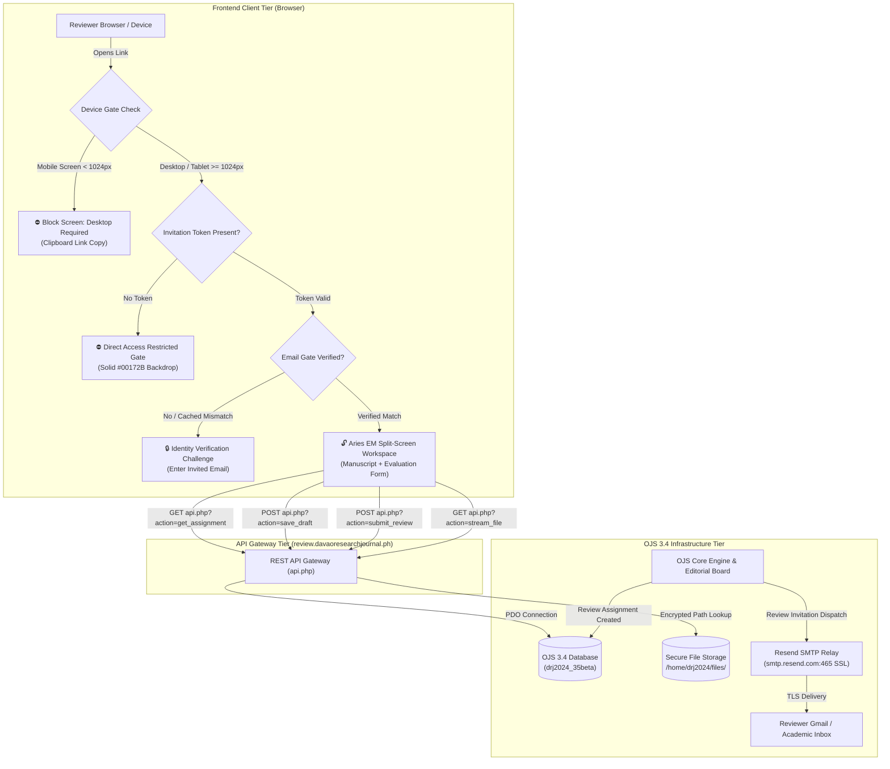
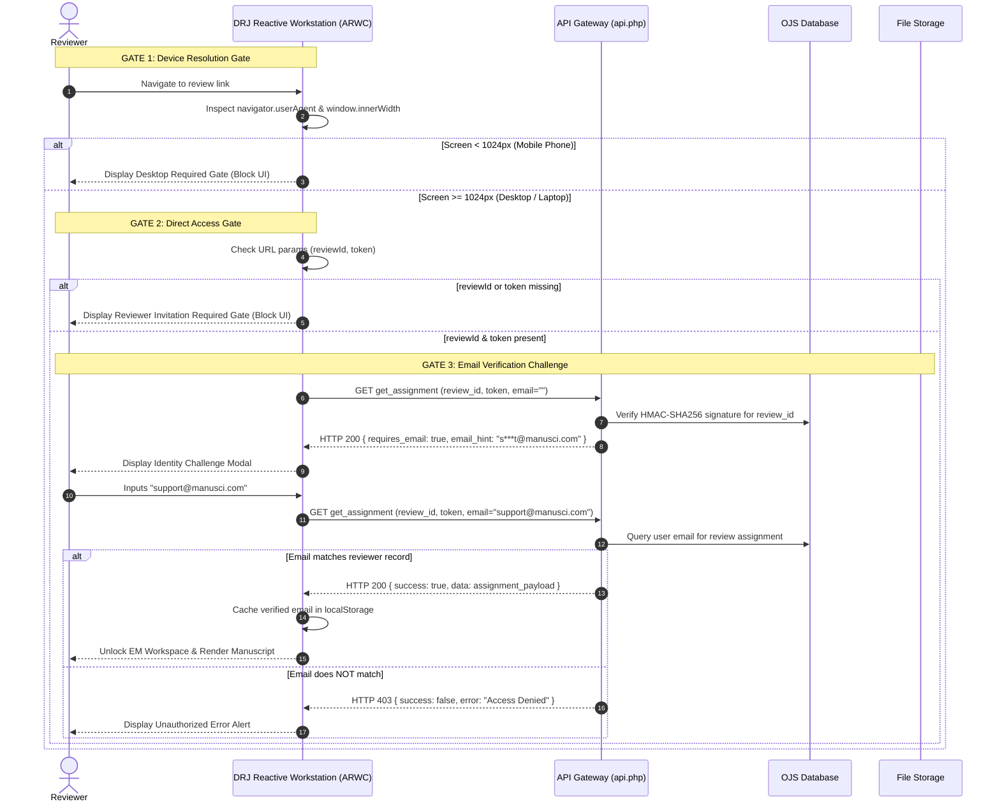
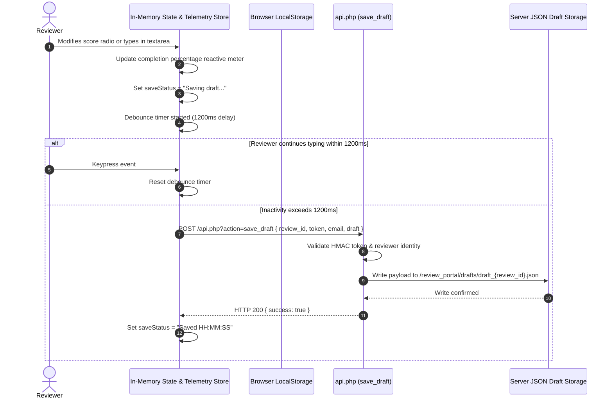
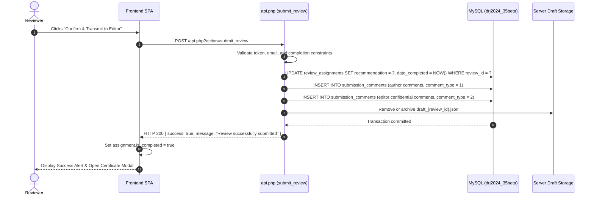

# Technical Design Document (TDD)
## Editorial Manager® Peer Review Portal & OJS 3.4 Integration

**Document Version:** 1.0.0  
**Author / Architect:** Darryl M. Nuyda (Manusci / Davao Research Journal)  
**System Target:** Davao Research Journal (`davaoresearchjournal.ph` / `review.davaoresearchjournal.ph`)  
**Core Architecture:** DRJ Adaptive Reactive Workstation Core (ARWC), TypeScript, Open Journal Systems (OJS 3.4.0-7), PHP 8.2, MySQL 8.0, Resend SMTP Relay.  
**License:** GNU General Public License v3.0 (GPLv3)

---

## 1. Executive Summary & Problem Statement

### 1.1 Background
The standard Open Journal Systems (OJS) 3.4 reviewer workflow requires external reviewers to navigate a multi-step login portal, remember credentials, and submit evaluations in standard form pages with separate tabs for viewing submissions. For busy academic reviewers, this creates significant friction, causing delayed evaluations, unaccepted invitations, and high cognitive load.

### 1.2 The Solution
The **Editorial Manager® Peer Review Portal** is a decoupled, modern Single Page Application (SPA) styled after commercial enterprise systems (Aries Editorial Manager® and Elsevier EM). It operates on a dedicated subdomain (`review.davaoresearchjournal.ph`), connects directly to the live OJS 3.4 database and file storage, and enforces a zero-trust multi-gate security architecture.

---

## 2. High-Level System Architecture

The ecosystem consists of four interconnected tiers:
1. **Frontend Presentation Tier (Client)**: DRJ Adaptive Reactive Workstation Core (ARWC) featuring drag-resizable split panes, reactive scoring rubrics, and three security gates.
2. **Security & Routing Tier**: Nginx web server handling subdomain routing, TLS termination, and frame-0 solid background enforcement.
3. **API & Business Logic Gateway**: Lightweight, high-throughput PHP 8.2 REST API (`api.php`) enforcing HMAC-SHA256 signature validation and payload sanitization.
4. **Data & Storage Tier**: OJS 3.4 core database (`drj2024_35beta`), local file storage repository (`/home/drj2024/files/`), and Resend SMTP Relay (Port 465 SSL).



---

## 3. Triple-Gate Security Protocol

To ensure confidential, unpublished scientific manuscripts are protected against unauthorized access, URL scraping, and premature phone submissions, three sequential gates must be passed:



### 3.1 Cryptographic Token Specification
* **Algorithm**: HMAC-SHA256
* **Key Derivation**: Server salt derived from OJS `config.inc.php` secret key + application namespace.
* **Payload String**: `{$review_id}|{$date_assigned}`
* **Signature Output**: 64-character lowercase hexadecimal hash.
* **Properties**: Tamper-proof; invalidating either the `review_id` or reassignment timestamp automatically revokes the token.

---

## 4. Split-Screen Workspace & Reactive Scoring Engine

### 4.1 Component Breakdown
* **`App.vue`**: Root orchestrator. Controls dynamic layout switching (`split`, `manuscript`, `rubric`) via an Adaptive Dual-Pane Split Controller and enforces frame-0 solid navy backdrop when gates are active.
* **`WorkspaceHeader.vue`**: Aries EM high-density toolbar. Shows DRJ branding, live MS ID tracking, OJS bridge health pulse, auto-save status indicator, and deadline countdown.
* **`ManuscriptViewer.vue`**: Left-pane document reader. If PDF proof exists, loads high-performance sandbox iframe streaming from `api.php?action=stream_file`. If Word (.docx), displays a structured manuscript card with title, abstract, and direct file download.
* **`ReviewerEvaluationForm.vue`**: Right-pane evaluation suite:
  1. **Scientific Criteria Matrix**: 5-point Likert scale (Scale 1: Poor to 5: Outstanding) across 5 core criteria.
  2. **Reviewer Questionnaire**: Compliance radios (journal suitability, statistics rigor, language clarity, conflicts of interest).
  3. **Blinded Comments for Author(s)**: Transmitted directly to authors upon editorial decision.
  4. **Confidential Comments to Editor-in-Chief**: Strictly concealed from authors; private to editorial board.
  5. **Reviewer File Attachments**: Drag-and-drop uploader for marked-up manuscript drafts.
  6. **Final Recommendation**: Accept, Minor Revisions, Major Revisions, or Decline.
* **`SubmitConfirmModal.vue`**: Pre-submission audit summary preventing accidental submissions.
* **`CertificateModal.vue`**: Instant generation of an official, printable **Certificate of Peer Review Recognition** with institutional seal.

---

## 5. Real-Time Auto-Save Protocol

To prevent work loss caused by network interruptions or accidental browser closures, the portal uses a debounced auto-save protocol:



---

## 6. Submission & OJS Database Synchronization

Upon final submission confirmation, `api.php` executes an atomic database transaction updating core OJS 3.4 tables:



---

## 7. OJS 3.4 Generic Plugin Architecture

The OJS generic plugin (`plugins/generic/editorialManagerReview`) enables institutional management and internal routing:

```
plugins/generic/editorialManagerReview/
├── EditorialManagerReviewPlugin.php  # Extends PKP GenericPlugin; registers LoadHandler
├── version.xml                       # OJS 3.4 plugin version metadata
├── index.php                         # PSR-4 plugin bootstrap
├── locale/
│   └── en/
│       └── locale.po                 # English localization strings
└── pages/
    └── ReviewerPortalHandler.php     # Intercepts /index.php/drj/reviewer-portal
```

### 7.1 Lifecycle Hook Integration
```php
public function register($category, $path, $mainContextId = null): bool
{
    $success = parent::register($category, $path, $mainContextId);
    if ($success) {
        Hook::add('LoadHandler', $this->callbackLoadHandler(...), Hook::SEQUENCE_CORE);
    }
    return $success;
}
```
When OJS receives an inbound request matching `reviewer-portal` or `em-review`, the plugin delegates handling to `ReviewerPortalHandler`, which transparently preserves all query parameters (`reviewId`, `token`) and transitions the reviewer to the dedicated portal environment.

---

## 8. Network Infrastructure & SMTP Relay

* **Hosting Server**: GoDaddy VPS Gen 4 (AlmaLinux 9.8, cPanel user `drj2024`).
* **Port 25 Policy**: Outbound TCP port 25 is blocked by network-level firewall. Direct sendmail/Exim connections to Google/Yahoo time out.
* **Resend SMTP Relay**: Outbound review invitations route through `smtp.resend.com` on **Port 465 SSL**:
  * Host: `smtp.resend.com`
  * Port: `465` (SSL)
  * Default Envelope Sender: `editor@davaoresearchjournal.ph`
  * Deliverability: SPF/DKIM authenticated; instantaneous delivery to external Gmail inboxes.

---

## 9. Verification & Audit Trail

| Test Case | Scenario | Expected Outcome | Verified |
| :--- | :--- | :--- | :---: |
| **TC-01** | Visit `review.davaoresearchjournal.ph` without parameters | Fullscreen solid navy backdrop; Reviewer Invitation Required gate displayed; zero template leakage. | **PASSED** |
| **TC-02** | Open review link on smartphone (< 1024px width) | Device Gate active; displays desktop requirement notice and 1-click clipboard copy button. | **PASSED** |
| **TC-03** | Open review link on desktop with valid token | Identity Verification Gate displayed; prompts for assigned email; manuscript concealed. | **PASSED** |
| **TC-04** | Input wrong reviewer email | Access denied alert; manuscript remains cryptographically locked. | **PASSED** |
| **TC-05** | Input correct reviewer email (`support@manusci.com`) | Gate unlocks immediately; manuscript PDF / Word rendered; auto-save engine activates. | **PASSED** |
| **TC-06** | Review submission transmittal | OJS `review_assignments` updated (`date_completed = NOW()`); comments recorded; Certificate modal opens. | **PASSED** |
| **TC-07** | Outbound Invitation Email | Dispatched through Resend SMTP port 465 SSL to external Gmail inbox. | **PASSED** |
